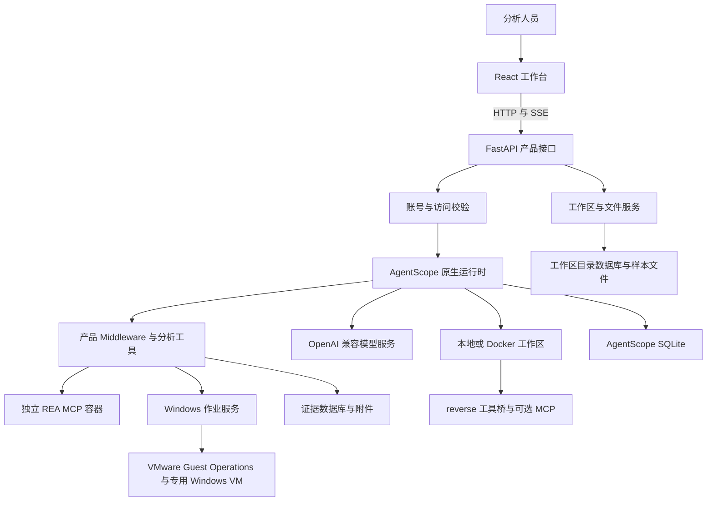

# Traceglass 系统设计

核对日期：2026-10-19。实现基线：`a75bd45`。本文描述当前系统，专项细节见 [文档导航](README.md)。

## 目标与范围

Traceglass 将逆向分析中的样本、对话、工具调用、协作任务和证据放到一个可检查的工作区。用户可以追踪某项结论来自哪次工具调用、哪份文件或哪个成员，并在中断后继续分析。

当前提供本地开发模式和基于账号的 Docker 工作区模式。REA、旧 reverse 工具桥、IDA 和 Windows 来宾环境按配置接入。普通文件上传、预览和工具搜索不会启动目标样本。

关键设计原则：

1. AgentScope 2.0.6 负责模型执行、ReAct、Task、Team、权限、会话和事件；产品代码围绕这些能力扩展。
2. 工作区、会话、回复、任务和证据有不同身份及生命周期，不能用一个状态代替其他状态。
3. 工具定义已注册、工具组已激活、服务已连接和操作已成功分别判断。
4. 样本及工具返回内容按不可信数据处理；分析结论需关联原件、范围和未解决问题。
5. 只在适用且已授权的环境中进行动态验证，静态分析容器不承担样本执行。

## 总体架构

模型请求由后端发出；Docker 分析工作区断网不等于后端无法访问模型。REA 单独运行，工作区以只读方式挂载到其 `/workspace`，主 Agent 和成员各自持有引擎连接及当前样本。

## 组件职责

| 组件 | 职责 | 实现入口 |
| --- | --- | --- |
| 应用组合 | 读取配置、组装原生服务、工具、Middleware 与生命周期清理 | [api/app.py](../src/traceglass/api/app.py) |
| 分析 Agent | 默认提示词、成员模板、出厂配置的兼容迁移 | [agents.py](../src/traceglass/agents.py) |
| 协作策略 | Todo 前置条件、任务归属、成员上限和 verifier 输入约束 | [delegation.py](../src/traceglass/delegation.py) |
| 工作区 | 所有权、样本目录、会话绑定、文件操作和后端路径映射 | [workspaces/](../src/traceglass/workspaces/) |
| 账号和模型 | Cookie 认证、CSRF、个人模型配置、凭据加密及 TLS 策略 | [accounts/](../src/traceglass/accounts/) |
| 工具接入 | 统一发现、按需分组、REA 连接、旧库适配及 Skill 安装 | [integrations/](../src/traceglass/integrations/) |
| 证据与复核 | 调用归档、引用查询、样本绑定及结构化覆盖检查 | [evidence/store.py](../src/traceglass/evidence/store.py)、[tools/review.py](../src/traceglass/tools/review.py) |
| Windows | 固定工具 profile、作业租约、调试操作和产物回收 | [windows/](../src/traceglass/windows/) |
| 前端 | 工作区操作、附件、原生事件投影、成员历史及证据展示 | [web/src/features/](../web/src/features/) |
| 评测 | 回放、静态夹具、产品编排和用量观测 | [evaluation/](../src/traceglass/evaluation/) |

`create_app()` 初始化数据库及配置后，通过原生 `create_agentscope_app()` 接入工具工厂和 Middleware 工厂。首次使用对应会话时才准备执行工作区；读取证据或产品配置不应启动分析引擎。

## 一次分析的数据流

1. 用户创建工作区并上传样本；产品保存文件、SHA-256 和路径元数据。
2. 创建原生会话并绑定工作区、主样本及当时的个人模型配置。额外附件通过本轮输入携带。
3. 前端提交 `/chat/`，原生运行时准备环境、构造模型上下文并执行工具循环。
4. Agent 按任务入口评估 REA，发现并激活适用工具；复杂任务通过原生团队分工。
5. 工具结果进入原生消息历史；适用的分析调用再由证据账本保存归档回执。
6. 成员提交原件位置与未解决路径，主 Agent 汇总 `AnalysisReview` 并写报告。
7. SSE 展示实时过程；刷新页面以持久化消息恢复历史，报告和样本保留在工作区。

## 四种状态边界

| 范围 | 主要状态或记录 | 含义 |
| --- | --- | --- |
| 原生会话与回复 | 准备、运行、等待、结束、中断及失败 | 本轮执行是否仍在活动 |
| 原生 Task | `pending / in_progress / completed` | 模型维护的计划与验收进度 |
| 分析覆盖 | 路径 `open / blocked / resolved` 和限定范围的 verdict | 证据覆盖及拟议结论 |
| 外部环境 | REA 连接、Windows job / operation / VM 恢复状态 | 外部资源及操作的真实状态 |

回复结束不自动完成 Todo；Todo 完成不证明行为路径已解决；引用完整性通过不证明语义判断正确。Windows 启动返回 PID 也不代表调试操作或结果回收成功。

## 持久性与并发

AgentScope 持久化消息、工具结果、团队、任务和 Agent 状态。产品分别保存账号、工作区目录、证据和 Windows 作业；工作区文件与证据附件保存在数据目录。详见 [数据模型](design/DATA_MODEL.md)。

消息总线、运行注册表、团队变更锁和 REA 配额位于当前 API 进程内，因此部署使用单个 worker。Windows 租约以 SQLite 事务持久化，但这不能使整个服务变成分布式执行系统。没有持久化的跨进程任务队列，也没有通用的外部调用恰好执行一次保证。

## 当前能力与演进边界

当前具有账号隔离、个人模型、按需工具、证据原件归档及 Windows 作业管理。尚无完整的管理员后台、用户总容量配额、分布式调度、独立的报告审批/版本发布产品，以及永久逐 token 审计日志。

扩展应沿用现有原生执行边界；增加新工具时同步考虑输入路径、权限、返回 schema、证据绑定、资源清理和测试。具体约束见 [接入设计](design/INTEGRATIONS.md) 与 [验证和决策](design/VALIDATION_AND_DECISIONS.md)。
