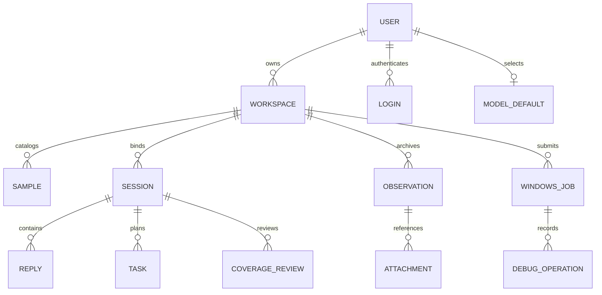

# 数据模型与证据设计

本页区分原生执行数据、产品目录、文件和证据。架构入口见 [系统设计](../DESIGN.md)。

## 存储布局

`TRACEGLASS_DATA_DIR` 指定部署数据根目录，默认 `traceglass-data`。下列路径相对此目录；文件按启用功能创建。

| 路径 | 内容 | 所有者 |
| --- | --- | --- |
| `agentscope.sqlite3` | Agent、凭据、会话、原生消息、团队、任务及 Agent 状态 | AgentScope SQLAlchemy 存储；凭据写入经过加密适配 |
| `accounts.sqlite3` | 用户、登录摘要、CSRF、限流及个人模型默认配置 | Accounts |
| `product-workspaces.sqlite3` | 工作区、样本目录和主样本与会话关联 | WorkspaceStore |
| `rea-evidence.sqlite3` | 通用工具调用、REA evidence 和 unknown 修订 | EvidenceStore；保留历史数据库名 |
| `credentials.key` | 个人模型 Key 的 Fernet 加密主密钥 | 后端私有文件 |
| `workspaces/` 或 `docker-workspaces/` | 工作区样本、报告、Skill 和其他文件 | 对应工作区后端 |
| `evidence-attachments/` | 按作用域分开的归档附件 | EvidenceStore |
| `windows-jobs/jobs.sqlite3` | Windows 作业、租约、启动标记及整机恢复状态 | WindowsService / WindowsScheduler |
| `skill-cache/`、`analyzer-inputs/` | 技能加载兼容副本、分析器输入副本 | 产品适配层 |

REA kit 和镜像由部署方单独准备；`TRACEGLASS_REA_KIT` 可以指向数据目录之外。REA 引擎还使用其独立 Docker volume，不能只备份 SQLite 就宣称保留了活跃引擎会话。

## 逻辑关系

这是跨存储的逻辑关系，不表示已创建这些名称的物理表或跨库外键。原生对象的表结构由 AgentScope 管理，产品依赖其存储接口。

## 产品表与字段

| 存储 | 表 | 关键字段和约束 |
| --- | --- | --- |
| 账号 | `users` | `id`；用户名唯一、不区分大小写；`password` 保存 scrypt 编码 |
| 账号 | `logins` | `digest` 为令牌 SHA-256；关联用户、CSRF 和过期时间，令牌原文不落库 |
| 账号 | `model_defaults` | 每用户一条默认 `credential_id / model / base_url`；不保存 API Key 原文 |
| 账号 | `rate_limits` | `key / count / reset`，事务计数 |
| 工作区 | `workspaces` | 主键 `(user_id, workspace_id)`；名称、描述、时间、历史标记 |
| 工作区 | `samples` | `sample_id`；用户与工作区作用域；样本元数据 JSON |
| 工作区 | `task_samples` | `session_id`；作用域与可空的主 `sample_id` |
| 工作区 | `legacy_imports` | 历史目录导入是否已执行及是否被截断 |
| 证据 | `rea_observations` | 自增 `seq`、唯一 `id`、作用域、kind、样本哈希、summary、raw、record |

实现见 [工作区目录](../../src/traceglass/workspaces/store.py)、[账号存储](../../src/traceglass/accounts/store.py) 与 [证据存储](../../src/traceglass/evidence/store.py)。数据库以参数化 SQL 和短事务操作，不提供跨 SQLite 与文件系统的统一事务。

## 样本身份与路径

上传结果包含 `sample_id / name / sample_path / sandbox_path / reverse_sample_path / sha256 / size / created_at`。存储文件名由服务端生成，展示名称不能当作文件身份。新产品工作区使用 `tgws-` ID，所有权参与主机目录映射；团队成员共享同一工作区文件。

同一文件在不同工具中的路径语义如下：

| 使用者 | 路径 |
| --- | --- |
| 文件 API、WindowsRunTool | 工作区相对路径，例如 `samples/<stored-name>.exe` |
| Docker 工作区 Bash / Read | 后端支持的工作区路径；容器绝对路径为 `/workspace/...` |
| REA | 独立容器内 `/workspace/...`，由 `PrepareAnalysisInput` 返回实际路径 |
| reverse MCP 的样本参数 | 相对 `/workspace/samples`，使用返回的 `reverse_sample_path` |
| 同机 IDA | 管理员显式启用后准备的宿主机输入副本；仅使用非空 `ida_file_path` |

`PrepareAnalysisInput` 核验文件身份并提供各后端路径。不能用字符串替换猜测远程工具的路径，也不能把一个引擎的会话句柄传给另一个引擎。

会话表关联一个主样本，输入区可同时携带多个附件。额外附件元数据随原生用户消息保存，不存在独立的多附件关系表。提取出的成员文件具有自己的哈希，引用不能自动冒充父归档的证据。

## 文件完整性与并发边界

[files.py](../../src/traceglass/workspaces/files.py) 限制上传为 100 MiB，文本预览为 256 KiB、二进制预览为 4 KiB；上传过程中计算 SHA-256 并通过临时文件发布。目录与文件操作拒绝越界路径和不允许的链接，下载使用已打开的文件并检查读取一致性。

删除样本前，产品接口检查工作区主会话及成员是否仍在准备、运行或等待；目录记录与文件操作不等于跨组件的全局事务锁。原生消息和历史主样本关联仍是历史记录，删除文件不自动抹除旧分析。

## 证据归档契约

[EvidenceLedgerMiddleware](../../src/traceglass/integrations/evidence_ledger.py) 对适用分析工具的完成结果归档，包括失败结果；工具搜索、Task/Team 操作、归档读取及 AnalysisReview 等被排除。没有完成回执的操作不能凭空生成成功证据。

记录包含调用工具、参数哈希、调用和会话身份、连接身份、样本绑定、原件哈希、保存部分的哈希、状态、位置、附件及时间。`tgev_<sha256>` 是本地归档回执，`ev_<sha256>` 等是上游 evidence 身份，两者不互换。

单份调用原件默认保存上限 1 MiB。超限记录保留截断标记和完整输出哈希，不能作为完整已验证引用。附件默认上限 8 MiB，按作用域及内容哈希保存，读取前校验完整性。

样本绑定来自运行时可核验的工作区文件、受信输入副本、明确绑定的引擎会话或 Windows job；模型在结果文字里声称的哈希不能直接成为绑定。没有唯一可信绑定的记录保留未绑定状态。

超过 16000 字符的适用工具结果可在发往模型的上下文副本中替换为归档回执及读取提示。原生已保存结果和展示内容保留；模型需按页读取相关原件，不能把回执当作内容已经读过。

## 覆盖、引用和结论

`AnalysisReview` 将记录存入原生 `AgentState.middle_context`，按 SHA-256 维护修订；每会话最多 32 个样本，每样本最多 64 条稳定 ID 的路径，每路径最多 20 条证据。

路径记录输入源、分派与解析、sink、授权、权限、证据、局限，以及独立的 `open / blocked / resolved`、漏洞类别、可利用性和动态验证字段。省略某条路径不会删除旧缺口。

新会话默认严格引用校验；历史覆盖记录按兼容策略处理。校验检查可访问性、保存内容哈希、截断、调用成功、附件、样本绑定和定位信息，返回具体失败原因。`review_passed` 表示结构检查；`references_passed` 表示引用检查；`recommended_verdict` 同时考虑结构与所选引用策略。定位字符串匹配仍不证明调用链语义。

声明良性、存在执行能力、存在漏洞和已证明可利用使用不同标签。字段契约见 [analysis_contract.py](../../src/traceglass/analysis_contract.py)，校验细节见 [review.py](../../src/traceglass/tools/review.py)。

## Windows 持久状态与恢复

Windows `jobs` 保存作用域内作业 JSON 和 revision；`windows_leases` 保存共享/独占租约及 VM generation；`windows_launches` 保存正在跨越启动边界的标记；`windows_vm` 保存整机代次、dirty、恢复状态及恢复进程身份。

状态更新用版本检查防止并发查询覆盖新操作，准入与恢复屏障使用 SQLite 事务。进程重启保留作业与租约；启动响应不确定、独占动态作业或恢复未确认时，不因进程退出而直接释放。所有控制同一 VM 的部署和维护工具应共用同一状态库。

## 备份与恢复限制

一致备份应包含所有数据库、工作区文件、证据附件、Windows 作业状态及 `credentials.key`。主密钥须与加密数据库配套；不承诺自动清除旧明文数据库页。

重启可恢复已保存消息和覆盖记录；不能恢复内存事件缓冲、运行协程、暂停恢复标记或 REA 活句柄。正在分析的 Windows VM 仍需根据作业真实状态收尾，不能把数据库还原视为虚拟机已恢复基线。
