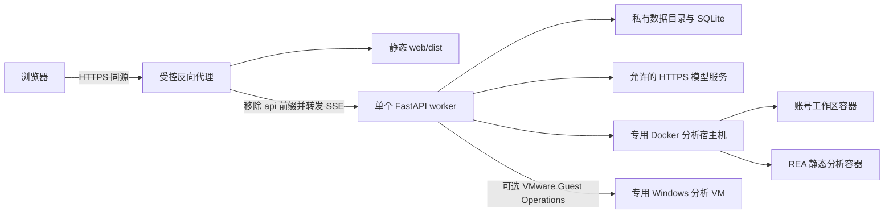

# 部署与安全设计

本页描述当前部署约束和运维边界；首次启动命令见 [项目 README](../../README.md)，配置细节见 [账号与模型](../ACCOUNTS_AND_MODELS.md)。

## 运行拓扑



当前代码要求单个 API worker：消息总线、运行注册表、团队锁和 REA 名额尚未跨进程共享。Windows 的持久租约不改变这一整体约束。对外服务前端使用构建产物，Vite 开发服务器仅供开发。

## 部署模式

| 模式 | 配置 | 使用范围 |
| --- | --- | --- |
| 本地开发 | auth 关闭，backend 为 local | 可信本机界面开发、文件查看和有界分析；目录不能隔离进程 |
| 单用户分析 | auth 关闭，backend 为 docker | 受信本机部署，可显式接入旧 reverse、IDA 和自定义 MCP |
| 账号工作区 | auth 开启，backend 必须为 docker | Cookie 认证、按用户目录和模型隔离；仍需部署层访问与容量控制 |

账号模式关闭原生任意资源管理接口、共享宿主机 IDA 和自定义部署 MCP。旧 reverse 领域桥和独立 REA 可用，仍需镜像、依赖及实际工具验证。

## 配置分层

[Settings.from_env](../../src/traceglass/config.py) 读取默认 `.env` 或 `TRACEGLASS_ENV_FILE`，进程环境优先；显式启用旧库时还可读取其配置，并由项目显式设置覆盖。

| 类别 | 关键配置 |
| --- | --- |
| 数据与执行 | TRACEGLASS_DATA_DIR、TRACEGLASS_WORKSPACE_BACKEND、TRACEGLASS_SANDBOX_IMAGE、TRACEGLASS_MAX_ITERS |
| 本地默认模型 | LLM_MODEL、LLM_API_KEY、LLM_BASE_URL、LLM_PARAMETERS |
| 账号 | TRACEGLASS_AUTH_ENABLED、TRACEGLASS_ALLOWED_ORIGINS、TRACEGLASS_SECURE_COOKIES |
| 个人模型访问 | TRACEGLASS_MODEL_ALLOWED_HOSTS、TRACEGLASS_MODEL_ALLOWED_ORIGINS、TRACEGLASS_MODEL_TLS_CONFIG |
| 工具与技能 | TRACEGLASS_LEGACY_PROJECT、TRACEGLASS_SKILL_ROOTS、TRACEGLASS_MCP_CONFIG、IDA_ENABLED、IDA_MCP_URL |
| REA | TRACEGLASS_REA_KIT、TRACEGLASS_REA_MAX_CONNECTIONS、TRACEGLASS_REA_QUEUE_WAIT_SECONDS、TRACEGLASS_REA_IDLE_SECONDS |
| 证据 | TRACEGLASS_STRICT_EVIDENCE_REFERENCES |
| Windows | TRACEGLASS_WINDOWS_CONFIG；其私有 JSON 引用的密码环境变量 |

账号模式不把部署者的模型 Key 交给新用户。用户保存新模型时创建版本化凭据，新会话使用新默认值，旧会话保留原模型及凭据引用。保存操作本身不请求模型；发现和测试是显式的在线动作。

公网账号模式的必要配置示例：

```dotenv
TRACEGLASS_AUTH_ENABLED=true
TRACEGLASS_WORKSPACE_BACKEND=docker
TRACEGLASS_ALLOWED_ORIGINS=https://traceglass.example.com
TRACEGLASS_SECURE_COOKIES=true
TRACEGLASS_DATA_DIR=/absolute/private/traceglass-data
TRACEGLASS_SANDBOX_IMAGE=local/traceglass-analysis:latest
```

部署前准备对应镜像和私有目录。API 只接受受控代理流量，代理按实际部署处理可信转发头、上传上限、SSE 缓冲及长连接超时。源码没有提供可直接投产的完整反向代理或容器编排方案。

## 信任边界与控制

| 边界 | 当前控制 | 限制 |
| --- | --- | --- |
| 浏览器 → API | Cookie、CSRF、Origin、所有权校验及接口允许列表 | 无邮箱验证、找回密码和完整管理后台 |
| API → 模型 | HTTPS 主机/精确 origin 允许列表、凭据加密、可选私有 CA | 测试/发现的目的地址检查不是原生推理的全局出站代理 |
| 用户 → 文件 | 工作区归属、路径检查、受限上传/预览和链接处理 | 目录权限不等于进程隔离，宿主机管理员仍能访问 |
| 工作区 → 主机 | 账号容器断网、无端口映射、移除 capabilities、禁止提权 | 不是强敌对租户的 VM 级隔离保证 |
| REA → 样本 | 单独断网容器、样本工作区只读挂载 | 引擎及商业依赖由部署方维护，活句柄不具跨重启保证 |
| API → Windows | 明确账号允许列表、固定 profile、凭据只在宿主、持久租约和恢复屏障 | Windows 系统状态共享，不是强多租户隔离 |
| 工具输出 → 模型/UI | 不可信数据提示、证据引用、受限渲染和文件导航 | 提示词约束不能代替执行环境限制和人工复核 |

账号工作区容器当前限制为 2 CPU、4 GiB 内存及 512 进程，内存与 swap 预算一致。它们是单容器限制，没有按用户总容器数、总存储或总模型费用配额。模型 HTTP 请求在 API 进程进行。

## 凭据与 TLS

账号密码以随机 salt 的 scrypt 编码保存，登录令牌只落摘要、有效期 7 天。个人模型 Key 使用 `credentials.key` 对应的 Fernet 加密；主密钥默认新建权限为 0600，不能放入工作区或提交到 Git。

模型地址允许列表控制协议、主机和端口，完整 `/chat/completions` 输入会规范为基地址。私有 CA 与 server_name 由管理员维护，证书链、有效期和名称校验保持开启，不通过关闭 TLS 校验接入服务。

Windows JSON 使用密码环境变量引用，禁止直接写明文密码。固定证书和来宾路径按部署准备，密码不进入模型 schema 或分析容器环境。动态执行须同时满足 allow_execution、有效固定基线、允许账号、任务授权和实际工具能力。

## 启停、迁移与备份

1. 启动前检查依赖、数据目录、模型访问策略、已加载分析镜像和 REA kit 指纹；Windows 按需检查能力。
2. 计划重启前查看主/成员运行状态、权限等待、后台工具及 Windows 活跃任务，给在途工作留出明确收尾路径。
3. 暂停保留已保存数据，但不能承诺撤销外部副作用；Windows 未确认作业保留查询与租约状态。
4. 停机备份或使用 SQLite 一致性备份，配套保存数据库、工作区、证据附件和主密钥。不要在运行中仅复制单个 SQLite 文件并假定一致。
5. 升级保留旧镜像与私有配置，核对框架兼容点；同名 Skill 更新按备份、预览 diff、空闲迁移执行。
6. 重启后核对登录、历史、文件及证据读取；需要活跃 REA 会话时重新打开目标。Windows 若处于 reset_required，不直接删租约后重新执行。

当前没有通用跨版本数据库回滚系统。恢复历史数据时必须匹配主密钥和代码兼容性；Windows VM 与其作业数据库需要一起核实，不能独立回滚后假定一致。

## 故障定位

| 现象 | 优先检查 |
| --- | --- |
| 模型拒绝请求 | 规范化基地址、模型名、Key、流式与工具调用支持、TLS 和允许列表；区分 HTTP 错误与模型正文 |
| 工具搜到但不能调用 | 实际激活组、schema、权限及服务连接；重新激活不等于修复 provider |
| REA 容量满 | GetReaStatus 的占用、排队、调用者连接及活跃调用；不要终止其他成员连接来腾名额 |
| REA 句柄失效 | 是否回收、释放或重启；重开目标，原归档通过证据接口读取 |
| 文件在引擎中找不到 | PrepareAnalysisInput 返回路径及引擎宿主；不要猜测挂载映射 |
| Windows busy | 容量、独占租约、dirty 与恢复状态；busy 不必然表示连接故障 |
| Windows unknown | 查询原 job / operation、保留租约，不自动重发启动 |
| 调试器会话发现失败 | 来宾就绪、插件/客户端版本、任务独立 TEMP 和会话发现日志；延长超时不能修复目录权限 |
| 引用检查失败 | scope、样本哈希、保存内容、截断、失败回执、附件及定位；不能用成员摘要替代原件 |
| 页面漏进展或重复内容 | 区分 SSE 连接、持久消息快照、任务状态及原生事件身份，不用页面空闲推断成功 |

故障记录应保留会话、调用或 job 身份、时间、错误阶段、输入身份及恢复动作；不把 Key、密码或私有启动配置写入可共享日志。
