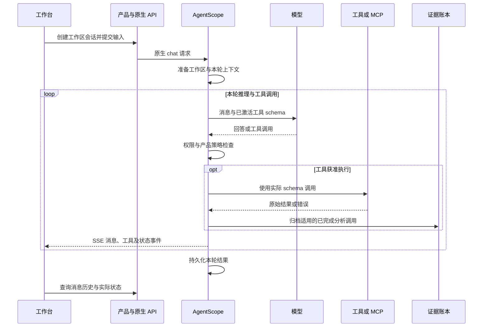

# 执行与协作设计

本页描述 AgentScope 2.0.6 上的产品执行策略。总体架构见 [系统设计](../DESIGN.md)。

## 对象与生命周期

| 对象 | 身份 | 生命周期与职责 |
| --- | --- | --- |
| 工作区 | `workspace_id` | 用户持有的样本、报告及多个分析会话的文件边界 |
| Agent | `agent_id` | 模型角色、提示词与配置；账号模式有稳定的个人主 Agent |
| 会话 | `session_id` | 持久化消息、Task、Team 关联及工作区绑定 |
| 回复 | `reply_id` | 一次原生执行，具有本轮预算和终态；同会话可多次继续 |
| Task | 原生任务 ID | 待办、owner、依赖和元数据；不是另一套运行实例 |
| Team | 原生团队 ID | 主会话与成员会话的关系、通信和协作历史 |
| 工具调用 | 工具调用 ID | 输入、结果、权限确认及归档回执的配对依据 |

产品代码没有固定的五阶段执行循环。模型按需求选择直接回答、使用工具或委派；复杂逆向任务由提示词引导先核验目标、建立 Todo，再按独立证据问题拆分。

## 主要执行流程

等待批准是原生执行的一部分。产品不因页面刷新、切换权限档位或收到迟到消息而代替用户批准待处理调用。

## 任务分配与成员约束

[TodoWrite](../../src/traceglass/tools/todo.py) 批量写入原生 Task 状态，保留任务身份、依赖与历史。[DelegationPolicy](../../src/traceglass/delegation.py) 在原生工具边界检查：

- `AgentCreate / AgentInvite` 关联明确的未完成 `task_id`；任务无冲突 owner 且前置依赖已完成。
- 定向 `TeamSay` 分配后续任务时，校验目标成员、任务状态、依赖和 owner，并沿用原生 TaskUpdate 权限。
- 每个团队最多 8 名成员，不含主 Agent；既有成员可复用。它是团队规模限制，不是所有用户的模型请求配额。
- 团队变更按主会话的进程内锁串行处理；模型发起的 `TeamDelete` 被拒绝，以保留成员证据和历史。

主 Agent 和成员共享该产品工作区的文件，但不共享 REA 当前二进制和活跃句柄。成员需用自己的连接打开目标，提交原始证据回执、位置、结论范围和缺口。

## 复核与验收

`AnalysisReview` 按样本 SHA-256 增量维护行为路径，省略旧路径不会删除缺口。主 Agent 汇总成员证据后再记录自己的覆盖状态。

创建 `verifier` 模板成员时，[verification.py](../../src/traceglass/verification.py) 从限定工作区的归档原件构造输入，包含拟议结论、范围、未解决路径和证据片段，不提供主 Agent 的完整推理历史。最多附带 20 份原件，每份最多 8000 字符、总片段预算 48000 字符；需更多上下文时读取归档原件。

独立复核有助于查找反例与遗漏，仍属于模型评审。结构检查、引用完整性检查、独立语义复核和主 Agent 的 Task 验收分别记录。

## 执行权限

产品提供 `default` 和 `bypass` 两种档位，持久化于原生 `permission_context`。`default` 由原生工具权限与规则决定放行或询问；工具标记只读不等于所有调用都会自动获准。`bypass` 跳过普通询问，但显式 deny / ask 规则和工具拒绝仍受原生权限语义约束。

权限切换使用产品接口，校验所有权和正在准备/运行的任务后，再交给原生更新处理器。主 Agent 新建成员沿用模板的权限继承；既有成员保留各自配置。执行权限档位不能覆盖 Windows 的管理员允许列表、执行开关或基线检查。

## 暂停与继续

工作台使用 `POST /product/sessions/{session_id}/interrupt`：`scope=session` 暂停本会话，`scope=team` 先暂停主会话、再重新读取并暂停自有团队成员，同时取消各会话登记的后台工具任务。若取消仍未完成，返回冲突并要求查询状态。

暂停保留消息、Task、覆盖记录和文件。取消本地协程不能撤销已经发生的写入，也不能保证外部独立进程已停止；Windows 任务需按其 job / operation 查询与收尾。

继续使用 `/chat/` 的 `input: null`，在同会话开启新回复。主 Agent 可通过明确点名的 `TeamSay` 给原成员分配新任务；迟到回报与广播不会解除暂停。相应一次性恢复标记保存在当前消息总线内，不是持久任务队列。

## 预算、压缩与异常

`TRACEGLASS_MAX_ITERS` 默认 2000，最后一次推理保留给模型总结；[closeout.py](../../src/traceglass/closeout.py) 禁止该次收尾发起新工具操作。成员的收尾正文可通过原生 TeamSay 定向送达主 Agent。适配层不生成新结论，也不替主 Agent 完成任务。

原生上下文压缩与迭代预算独立。压缩后的模型上下文不是完整原文，持久化历史仍供查看。模型失败或没有生成可用总结时保留真实错误，不伪造交付结果。

工具 schema 不匹配、权限拒绝、连接失败、容量不足、执行失败和结果不确定需要分开处理。接入层不自动重放含副作用或状态不明的调用；只在确认前置条件及当前外部状态后，由分析过程选择下一步。

## 兼容点与验证

[agentscope_compat.py](../../src/traceglass/integrations/agentscope_compat.py) 适配工作区文件缓存、最后一次推理期间的 inbox 唤醒以及暂停成员恢复；[api/runtime.py](../../src/traceglass/api/runtime.py) 组合原生中断与权限更新。它们依赖锁定框架版本的内部接口，升级前要复测原生执行、暂停继续、文件缓存、权限和团队。

对应测试：`test_native_execution.py`、`test_pause_continue.py`、`test_native_wakeup.py`、`test_execution_permissions.py`、`test_native_file_cache.py`、`test_native_verifier.py` 及 `test_delegation.py`。完整映射见 [验证设计](VALIDATION_AND_DECISIONS.md)。
