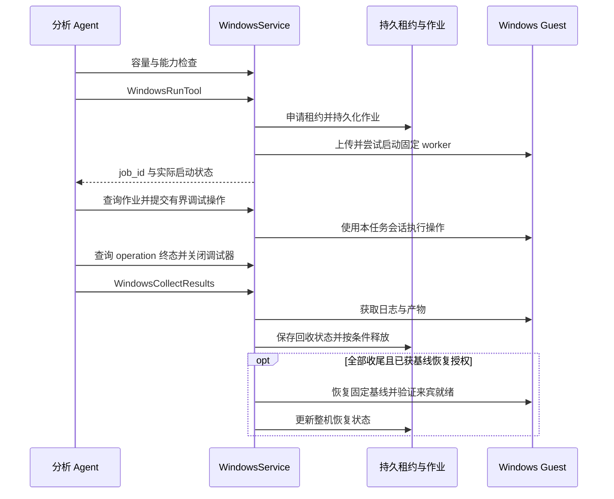

# 工具与 Skill 接入设计

工具能力通过 AgentScope Toolkit、ToolGroup 和 MCP 接入。产品提供发现、路由提示和生命周期适配，底层工具保留自己的名称、参数与结果契约。总体架构见 [系统设计](../DESIGN.md)。

## 工具使用的四个阶段

| 阶段 | 依据 | 不能据此推断的事 |
| --- | --- | --- |
| 注册 | 当前 Agent 的工具定义或有效缓存 | provider、容器或外部服务已启动 |
| 激活 | 对应原生组进入本轮 schema | 已获执行权限或工具参数完全兼容其他引擎 |
| 连接 | 当前会话的连接状态和能力探测 | 目标格式、功能和全部 provider 可用 |
| 执行与回收 | 真实工具结果、job / operation 终态和归档原件 | 结论语义正确或样本安全 |

模型先用 `SearchAnalysisTools` 查询已注册工具及未激活组，根据结果调用原生 `reset_tools`，等待激活成功、读取实际 schema 后调用。`reset_tools` 替换全部可选组，因此要保留仍需的组。搜索本身不执行样本，也不代表工具已经被调用。

能力目录推荐首选与备用入口；反编译、原始字符串提取、索引字符串搜索、FLOSS 恢复字符串等具有不同证据含义，不能互相当作别名。实现见 [tool_catalog.py](../../src/traceglass/integrations/tool_catalog.py) 与 [tool_policy.py](../../src/traceglass/integrations/tool_policy.py)。

## 工具来源

| 来源 | 接入方式与条件 |
| --- | --- |
| AgentScope 原生工具 | 工作区文件、执行、Skill Viewer、Task / Team 及权限流程 |
| 产品分析工具 | TodoWrite、PrepareAnalysisInput、AnalysisReview、证据查询及可选 Windows 工具 |
| local 扩展 | 本地模式附加 inspect_file、extract_strings、write_report |
| reverse MCP | 配置旧 reverse 项目后使用 Docker 桥接领域实现；旧 Agent 工厂不导入 |
| REA MCP | 配置经过验证的 kit，按会话延迟建立独立连接 |
| IDA 与自定义 MCP | 单用户部署按配置接入；账号模式关闭共享宿主机 IDA 和自定义部署 MCP 入口 |

## Skill 来源和路由

当前内置 19 个 Skill 包。来源优先级为：自动继承的旧库默认包 → 项目内置包 → `TRACEGLASS_SKILL_ROOTS` 显式配置包。同目录名以后者覆盖；多个显式根中的歧义会被拒绝。不同目录中 frontmatter 名称冲突时，加载兼容副本使用限定名称，原始来源不改写。

`traceglass-analysis` 统一任务入口和证据契约；`rea-analysis` 负责本项目中的格式选择、能力发现和工具激活；上游 `reverse-engineer-anything` 提供 REA 方法参考。专项方法、平台、引擎操作和交付技能按需读取。

每项新任务或目标变化时先评估 REA 的相关能力。同一任务复用已有判断；文档、普通源码阅读或已有报告解析可记录不适用原因并直接处理。当前实现属于 Skill 与系统提示引导，没有强制每个任务调用 REA 的运行门禁。

新工作区安装配置中的 Skill；已有工作区启动只补缺失名称，不覆盖同名用户修改。`audit_skills.py` 检查来源及内容哈希；`migrate_skills.py` 通过 prepare / apply / rollback 显式迁移，需确认工作区空闲。服务重启不能替代同名 Skill 升级。详见 [Skill 整理](../SKILL_ORGANIZATION.md)。

## REA 版本、元数据和会话

项目发布锁固定 `rea-agents 6.3.0`。构建脚本校验 npm 包完整性、基础镜像身份和构建结果，kit 的 `MANIFEST.json` 指向不可变镜像 ID；`TOOLS.json` 同时绑定 kit 指纹和工具 schema 哈希。

元数据有效时可注册延迟代理，不启动分析容器。缓存缺失或不匹配时，不使用旧定义伪装成功；`ConnectRea` 可进行元数据发现，此过程可能临时连接容器，但不打开或执行目标。

首次实际调用为 `(工作区根目录, user_id, session_id)` 建立连接。容器断网、移除 capabilities、禁止提权，工作区只读挂载在 `/workspace`；引擎状态位于独立 volume。主 Agent 和成员不能假设共享已打开目标。

| 配置 | 默认值 | 含义 |
| --- | --- | --- |
| `TRACEGLASS_REA_MAX_CONNECTIONS` | 10 | 当前 API 进程内的驻留连接上限 |
| `TRACEGLASS_REA_QUEUE_WAIT_SECONDS` | 30 秒 | 等待连接名额的时长，不是重试工具调用 |
| `TRACEGLASS_REA_IDLE_SECONDS` | 600 秒 | 无活跃调用时的空闲回收；0 关闭此回收 |

`GetReaStatus` 查询容量和调用者持有状态，不创建连接；纯文本成员和归档读取不占连接。`ReleaseReaSession` 只能释放调用者自己的空闲连接；普通完成回复及已验收成员也可释放空闲连接，活跃调用不被清理打断。

空闲回收、显式释放或服务重启后，活句柄失效，需检查 `binary_session` 并重新打开目标；归档 ID 仍可读取。代理还核对实际连接 schema 与注册 schema，一旦变化就拒绝执行并要求刷新元数据。容量耗尽和连接失败分别返回状态，不自动重放调用。

原生 workflow 查询提供分析指导，不等于执行 workflow。完整配置见 [REA 集成](../REA_INTEGRATION.md)，实现见 [rea.py](../../src/traceglass/integrations/rea.py)。

## Windows 调试通道

宿主机读取管理员私有 `WindowsConfig`，通过 pyvmomi 的 VMware Guest Operations 上传固定 worker、输入文件和作业请求，再启动配置中的 Python。网页用户和模型不接触 ESXi / Windows 密码，工具不提供任意宿主机或任意远程命令入口。

工具集中于 `windows_analysis` 组。`WindowsVmStatus` 只读查询本地容量与恢复屏障，不连接 ESXi；`WindowsCapabilities` 实际检查来宾能力，工具路径存在与调试依赖可用分别报告。

动态路由先静态确认样本格式、架构、哈希和待验证问题，再检查授权、允许执行、基线和对应调试依赖。当前调试入口覆盖 Windows 原生 x64 / x86 EXE，不能据此宣称支持 DLL、驱动、ARM64 或托管专用调试。

静态任务默认共享，动态任务默认独占；已授权且允许共享系统状态的普通程序可明确使用共享模式。恶意性未知、会修改系统或遗留后台进程的目标使用独占，不为绕过占用而改成共享。

并发配置默认 1，示例为 8，支持 1–64。共享目录和 TEMP 按任务区分，但注册表、网络、服务和系统文件仍共享。容量满返回 busy，没有后台作业等待队列。

启动请求发出后响应不明时保存 `unknown` 和租约，查询原 job，不重放。调试操作具有独立 `operation_id`，前一操作未确认时不提交下一次；正常执行、启动会话成功、内存读取和 dump 成功分别核验。

关闭调试会话并回收有效终态结果后，共享作业可释放自身槽位；独占动态作业按恢复策略保留租约。运行过目标的一批任务全部结束后需恢复固定基线，自动恢复默认关闭。其他任务仍占槽或有未确认启动时，事务屏障拒绝整机恢复。

实现入口为 [service.py](../../src/traceglass/windows/service.py)、[scheduler.py](../../src/traceglass/windows/scheduler.py)、[guest.py](../../src/traceglass/windows/guest.py)。部署与具体操作见 [Windows 来宾工具](../WINDOWS_GUEST_TOOLS.md)。

## 新工具接入清单

新增工具需明确：适用格式、输入路径、权限语义、返回 schema、样本绑定依据、失败和截断表示、操作是否有副作用、超时或 unknown 的查询方法、资源释放及离线/实机验证范围。需要原生分组时登记目录描述，不用通用参数包装器抹平引擎差异。
